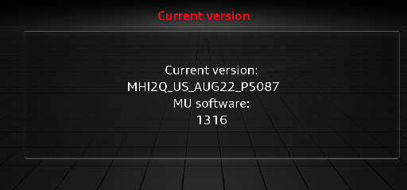
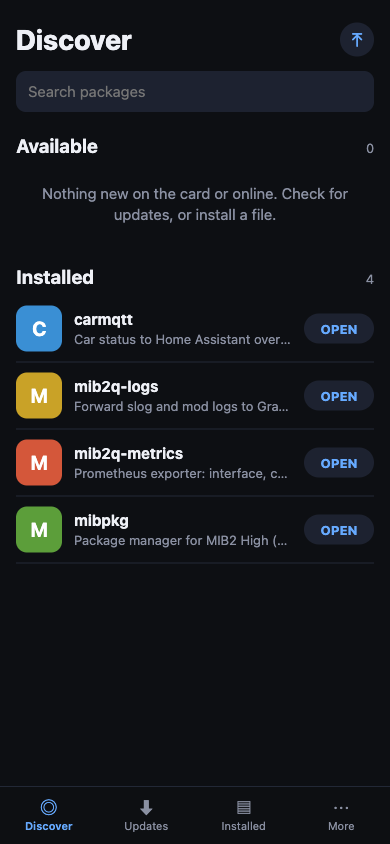
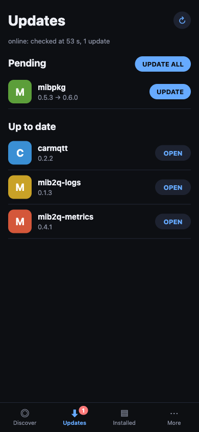
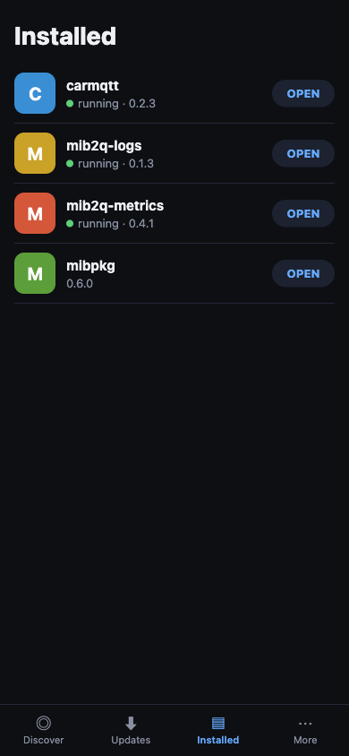
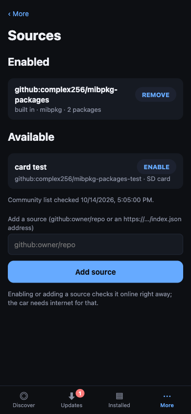
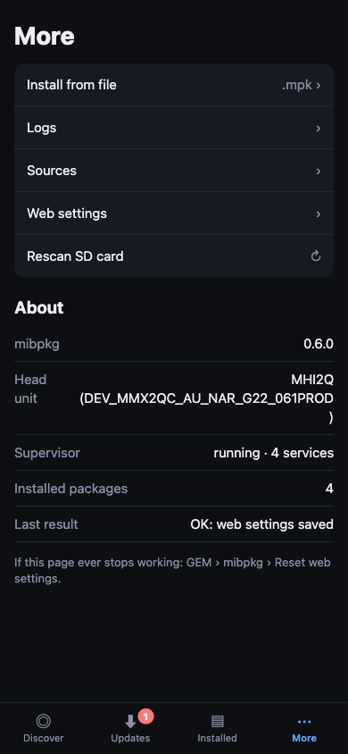
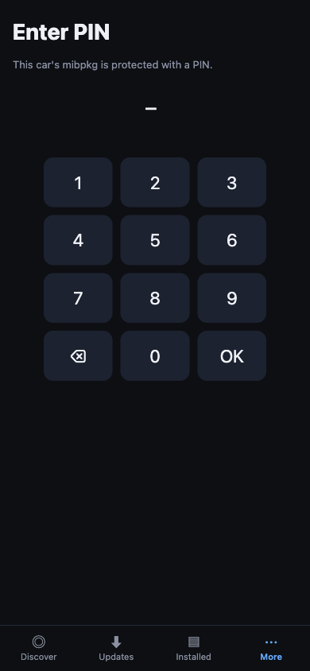

# Installing mibpkg — step by step

This guide walks you through installing mibpkg on a MIB2 High head unit from start to finish, with
nothing assumed. If you can format an SD card and tap through a menu in your car, you can do this.

**What you'll end up with:** mibpkg running on your unit, reachable from your phone's browser, ready
to install and manage software.

**Time:** about 15 minutes. **Risk:** low — mibpkg backs up every file it changes and can be fully
removed, and a `DISABLE` card stops everything if anything goes wrong.

> 📸 *[Image: the mibpkg "Discover" screen open in a phone browser — the finished result.]*
> `docs/install-images/00-result.png`

---

## Before you start

You need:

- An **Audi/VW MIB2 High** unit — model **MHI2** or **MHI2Q**. (Both are supported; you don't need
  to tell them apart to install. How to check below.)
- An **SD card** (any size; 2 GB is plenty) and a computer with an SD reader.
- The latest **`mibpkg-sd-<version>.zip`**.

### Check your unit is a MIB2 High

The engineering menu shows your unit's version, which starts with the model name:

1. In the car, **hold the NAV/MAP and MEDIA buttons together for about 7 seconds** to open the
   engineering menu.
2. Choose **Version information**.
3. Look at the **Current version** line. If it starts with **`MHI2`** — for example
   `MHI2Q_US_AUG22_…` or `MHI2_…` — you have a MIB2 High unit and you're good to go.
4. To leave the engineering menu, **hold NAV/MAP + MEDIA together for ~7 seconds again** (the Back
   button does not exit it).

  

There are two ways to install. **Method A (engineering menu)** needs no other software and is the
recommended path for most people. **Method B (M.I.B.)** is a one-tap alternative if you already run
M.I.B. Pick one.

---

## Method A — Engineering menu (recommended, no M.I.B. needed)

### Step 1 — Format the SD card as MS-DOS (FAT), **Master Boot Record**

This is the one step people get wrong. The unit only reads cards partitioned with the **Master
Boot Record (MBR)** scheme — the default on many computers is *GUID*, and a GUID card makes the
SD-card option in the update menu **greyed out**.

**macOS (Disk Utility):**
1. Open **Disk Utility**, click **View → Show All Devices**.
2. Select the **whole SD card device** (the top-level entry, not the volume under it).
3. Click **Erase** and set:
   - **Format:** `MS-DOS (FAT)`
   - **Scheme:** `Master Boot Record`
4. Click **Erase**.

> 📸 *[Image: macOS Disk Utility Erase dialog showing Format = MS-DOS (FAT), Scheme = Master Boot
> Record.]* `docs/install-images/01-sd-format-mac.png`

**Windows:** use **SD Memory Card Formatter** (or `diskpart`); make sure the card ends up **FAT32**
on an **MBR** disk, not a single GUID/GPT partition.

### Step 2 — Copy the files onto the card

Unzip **`mibpkg-sd-<version>.zip`** and copy its **contents** to the **root** of the SD card — so
`metainfo2.txt` sits at the top level of the card, next to the `mibpkg/` and `mod/` folders. Then
safely eject the card.

> 📸 *[Image: the SD card's root folder showing metainfo2.txt, mibpkg/, mod/, _Swdlautorun.txt.]*
> `docs/install-images/02-card-contents.png`

### Step 3 — Insert the card into **SD1**

Put the card in the unit's **SD card 1** slot.

> 📸 *[Image: inserting the SD card into the SD1 slot of the head unit.]*
> `docs/install-images/03-insert-sd1.png`

### Step 4 — Open the engineering (Red) menu → SW Update

Open the unit's engineering / Red menu and choose **Software Update** (SWDL). Select **SD card 1**.

> 📸 *[Image: the SW Update screen with SD card 1 selected.]*
> `docs/install-images/04-sw-update.png`

### Step 5 — Select "mibpkg installer" and start

In the update list you'll see **`mibpkg`** marked **`[Y]`** (installable). The other rows
(IOC, GPS, …) show `[N/A]` — that's normal.

> 📸 *[Image: the update list with "mibpkg [Y]" highlighted and "Start update" below.]*
> `docs/install-images/05-mibpkg-listed.png`

### Step 6 — Let it install and reboot

The install runs and the unit restarts a few times to finish. This is normal — **don't pull the
card or power during the process.** When it settles you'll be back at the normal screen.

> 📸 *[Image: the install progress / reboot screen.]* `docs/install-images/06-installing.png`

### Step 7 — Open mibpkg

**You use mibpkg from your phone's browser — that's the main interface.** See
**[Using the web interface](#using-the-web-interface)** below.

The in-car **GEM → mibpkg** screen is just a backup: it shows the web address and has recovery
buttons (remove a forgotten PIN, reset the web settings, remove mibpkg) for when you can't reach the
web interface. You rarely need it.

✅ **Done.** Go to [Using the web interface](#using-the-web-interface).

---

## Method B — M.I.B. "Run Custom Script"

If you already run M.I.B., this is a one-tap install.

1. Unzip **`mibpkg-sd-<version>.zip`** onto your M.I.B. SD card (same card is fine).
2. Insert it, then open **GEM → M.I.B. → Advanced Settings → Run Custom Script**.
3. Wait for it to finish, then open **GEM → mibpkg** or the web interface.

> 📸 *[Image: GEM → M.I.B. → Advanced Settings → Run Custom Script.]*
> `docs/install-images/07-mib-run-custom-script.png`

---

## Using the web interface

mibpkg is easiest to use from your phone.

1. Join the car's **Wi-Fi hotspot** from your phone.
2. In the car, open **GEM → mibpkg** — it shows the address, e.g. `http://10.255.1.1`.
3. Open that address in your phone's browser.

From there:

<table>
  <tr>
    <td align="center"> <b>Discover</b> — browse and install packages.</td>
    <td align="center"> <b>Updates</b> — one tap to update everything.</td>
    <td align="center"> <b>Installed</b> — see what's running.</td>
  </tr>
  <tr>
    <td align="center"> <b>Sources</b> — add a community repo.</td>
    <td align="center"> <b>More</b> — install a .mpk, logs, settings, health.</td>
    <td align="center"> <b>PIN</b> — optionally lock the interface.</td>
  </tr>
</table>

- **Install a package:** open **Discover**, tap a package, tap **Install**.
- **Install a `.mpk` from your phone:** **More → Install from file**.
- **Update everything:** **Updates → Update all**.
- **Add an online source:** **More → Sources → Add source** (`github:owner/repo`). The car checks it
  when it has internet.

The web interface is only accessible over the car's **Wi-Fi hotspot** or **Tailscale**. You can set
a **PIN** for it under **More → Web settings**.

---

## Troubleshooting

**The SD-card option is greyed out in the update menu.**
The card isn't partitioned as the unit expects. Re-do **Step 1** and make sure the scheme is
**Master Boot Record** (not GUID), formatted **FAT32**.

**"MOST considered unstable" popup.**
On a bench or a car without a live MOST bus, the unit flags the bus unstable. mibpkg suppresses this
automatically — if you see it once right after installing, it won't come back on later boots.

**It keeps returning to the software-update summary.**
Pull the SD card out of the unit and restart the car; it will boot normally.

**GEM → mibpkg tile isn't there.**
mibpkg turns the engineering menu on itself, but the menu reads that setting at boot — so on a fresh
install it may take **one more normal reboot** for the tile to appear. In the meantime, use the
**web interface**, which is always available.

**Something's wrong and I want everything off.**
Create an empty file named `DISABLE` in the `mibpkg` folder on the card (`mibpkg/DISABLE`) and
reboot. No mibpkg-managed services start while it's present.

**Remove mibpkg.**
Two easy ways, each with a confirmation:
- **From your phone:** web interface → **More → Remove mibpkg**. Tick the acknowledgement, then
  choose **Remove** (keeps installed files, so you can reinstall later) or **Remove and delete
  everything** (also deletes all mibpkg files and restores the stock files it changed).
- **In the car:** **GEM → mibpkg → Remove mibpkg**, then confirm on the next screen (same two
  levels).

---

## Screenshots to capture

This guide reads fine as-is, but these images make it shine. Capture each and drop it at the path
shown; they'll render in place.

- [ ] `docs/install-images/00-result.png` — the mibpkg **Discover** screen in a phone browser.
- [ ] `docs/install-images/01-sd-format-mac.png` — Disk Utility **Erase** dialog: Format **MS-DOS
      (FAT)**, Scheme **Master Boot Record**.
- [ ] `docs/install-images/02-card-contents.png` — the SD root showing `metainfo2.txt`, `mibpkg/`,
      `mod/`, `_Swdlautorun.txt`.
- [ ] `docs/install-images/03-insert-sd1.png` — inserting the card into **SD1**.
- [ ] `docs/install-images/04-sw-update.png` — the **SW Update** screen with SD card 1 selected.
- [ ] `docs/install-images/05-mibpkg-listed.png` — the update list with **mibpkg installer [Y]**
      highlighted. *(You already captured a version of this during testing.)*
- [ ] `docs/install-images/06-installing.png` — the install/reboot progress screen.
- [ ] `docs/install-images/07-mib-run-custom-script.png` — GEM → M.I.B. → Advanced Settings → Run
      Custom Script.

Images are referenced at phone size; a straight-on photo or a dash-cam/HDMI capture of the screen is
perfect. Once a file is in place, replace its 📸 placeholder line with:
``.
