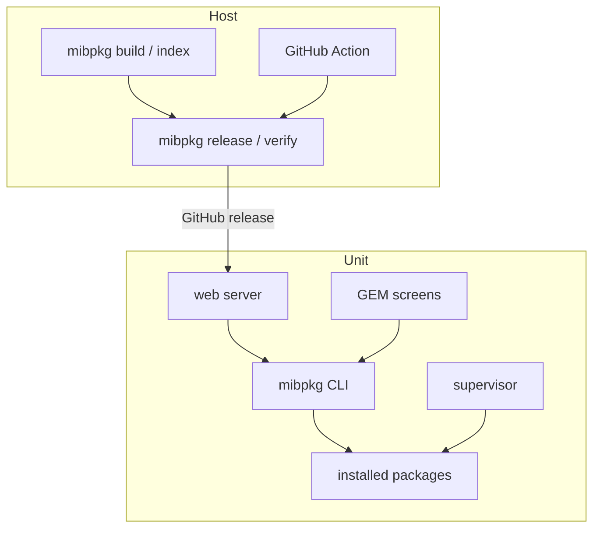
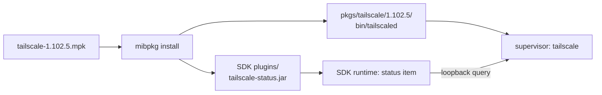

# Architecture

mibpkg is one Rust binary with two lives: host tooling and an on-unit package manager.

## Host tooling

Host commands build and publish:

- `mibpkg build` — a `.mpk` from a source directory.
- `mibpkg index` — `index.json` for a collection.
- `mibpkg release` — a GitHub release with the index and packages.
- `mibpkg verify` — check a collection or card the way a car would.
- `mibpkg new` — a runnable package skeleton.

They use the same manifest parser and archive code as the unit, so a package that builds is a package
the unit can read.

## On the unit

| Component | Role |
|---|---|
| CLI | Actions, installs, grants, SDK verbs |
| Supervisor | Starts and restarts services; runs the boot checks |
| Web server | The phone interface and JSON API |
| GEM screens | In-car status and recovery buttons |
| Boot hook | Starts the supervisor from `startup.sh` |
| Package store | `/mnt/app/root/mibpkg/pkgs` |

The CLI and web server never run plugin code. A plugin runs in the SDK runtime; mibpkg only writes its
jar and grants.

## Two packages, one product

A native daemon and its SDK status plugin ship as one package:

The package name is the install/update identity. The plugin keeps its own id for grants, data, icons and
reload. Removing the package removes both halves.

## The web server

The web server is a static bundle embedded in the binary. It serves:

- the HTML/CSS/JS interface;
- the JSON API;
- uploads and job output.

It runs as the supervisor's `mibpkg.web` service. A self-update restarts it.

## Storage

| Area | Purpose |
|---|---|
| `/mnt/app/root/mibpkg/pkgs` | Package files and versions |
| `/mnt/app/root/mibpkg/state` | Config, backups, boot entries, GEM data |
| `/mnt/persist/mibsdk` | SDK plugin data |
| `/tmp` | Runtime markers, logs, uploads |

`/mnt/app` is normally read-only and is remounted for writes under a holder protocol. `/tmp` is RAM.

## Related

- [Package layout](../reference/package-layout.md)
- [Safety and recovery](safety-and-recovery.md)
- [Boot and supervisor](boot-and-supervisor.md)
