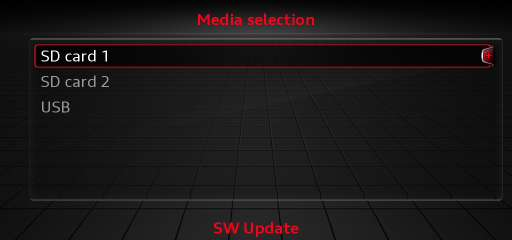
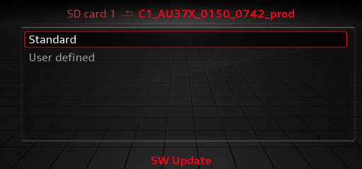
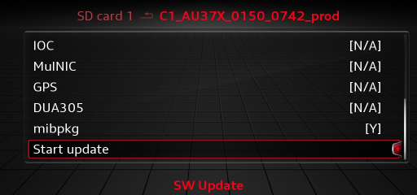
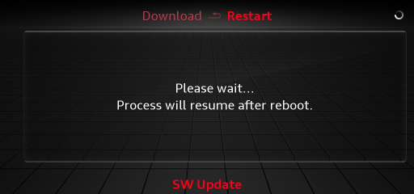

# Install

This is the engineering-menu method. It needs no other software on the unit and is the recommended
path.

## 1. Format the SD card

The unit reads cards partitioned with the **Master Boot Record (MBR)** scheme. A card formatted with
GUID/GPT makes the SD-card option in the update menu greyed out.

=== "macOS"

    1. Open **Disk Utility** and choose **View → Show All Devices**.
    2. Select the **whole SD card device**, not the volume under it.
    3. Click **Erase**, set **Format** to `MS-DOS (FAT)` and **Scheme** to `Master Boot Record`.
    4. Erase.

=== "Windows"

    Use **SD Memory Card Formatter**, or `diskpart`. The card must end up FAT32 on an MBR disk, not a
    single GUID/GPT partition.


## 2. Copy the image

Unzip `mibpkg-sd-<version>.zip` and copy its **contents** to the **root** of the card, so
`metainfo2.txt` sits at the top level next to `mibpkg/` and `mod/`.

```text
/
├── metainfo2.txt
├── _Swdlautorun.txt
├── mibpkg/
└── mod/
```

Eject the card safely.


## 3. Insert the card in SD1

Put it in the unit's **SD card 1** slot.


## 4. Open the engineering menu

Open the engineering (Red) menu and choose **Software Update**. Select **SD card 1**.



## 5. Start the update

Choose **Standard**. Scroll to the bottom of the list: **`mibpkg`** is marked **`[Y]`**. The stock
rows show `[N/A]`; that is normal. Select **Start update**.

!!! note "Building your own card"
    The engineering menu accepts only a card with a genuine signed `metainfo2` header. The release
    image includes one. If you build a card with `scripts/bundle.sh`, pass
    `--signed-header <file>`; without it, use the custom-script method.





## 6. Wait for the reboots

The install runs and the unit restarts a few times. Do not pull the card or cut power.



## 7. Open mibpkg

The main interface is the web page served by the car. Join the unit's Wi-Fi hotspot and open
**GEM → mibpkg** for the address. See [First use](first-use.md).

The in-car **GEM → mibpkg** screen is the backup interface: it shows the address and has recovery
buttons for a forgotten PIN, broken web settings, and removing mibpkg.


## If the SD-card option is greyed out

The card is not MBR/FAT32. Reformat it and try again.

## Next

- [First use](first-use.md)
- [Custom-script install](install-custom-script.md)
