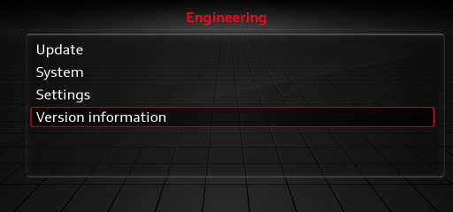

# Requirements

## The unit

mibpkg runs on a **MIB2 High** unit, model **`MHI2`** or **`MHI2Q`**, on QNX 6.5. You do not need to
tell the two models apart to install.

To check:

1. In the car, hold **NAV/MAP** and **MEDIA** together for about 7 seconds to open the engineering
   menu.
2. Choose **Version information**.
3. The **Current version** line starts with `MHI2` or `MHI2Q` on a supported unit.
4. Hold **NAV/MAP** and **MEDIA** again to leave the menu; Back does not exit it.

!!! warning
    Other MIB2 variants and other platforms are not supported. The package format and the boot hook
    are specific to the MIB2 High.

## What you need

| Item | Notes |
|---|---|
| An SD card | Any size; 2 GB is plenty |
| A computer with an SD reader | macOS, Windows or Linux |
| `mibpkg-sd-<version>.zip` | The release image |
| About 15 minutes | The unit reboots a few times during install |

## What the installer changes

mibpkg installs on the writable app partition. It does not reflash the IFS image. It adds:

- the `mibpkg` directory and its collection;
- a boot hook that starts the supervisor;
- a GEM entry for the status and recovery buttons;
- firewall rules for the web interface on the hotspot.

Every stock file it touches is backed up once, and uninstalling restores it. See
[Safety and recovery](../explanation/safety-and-recovery.md).

## Next

- [Install](install.md)
